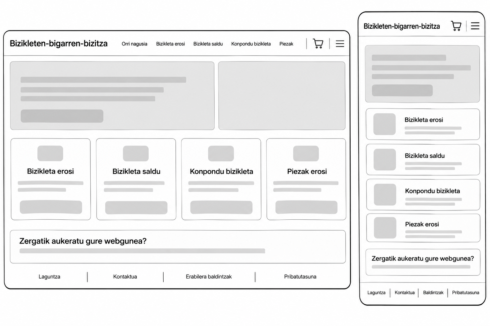
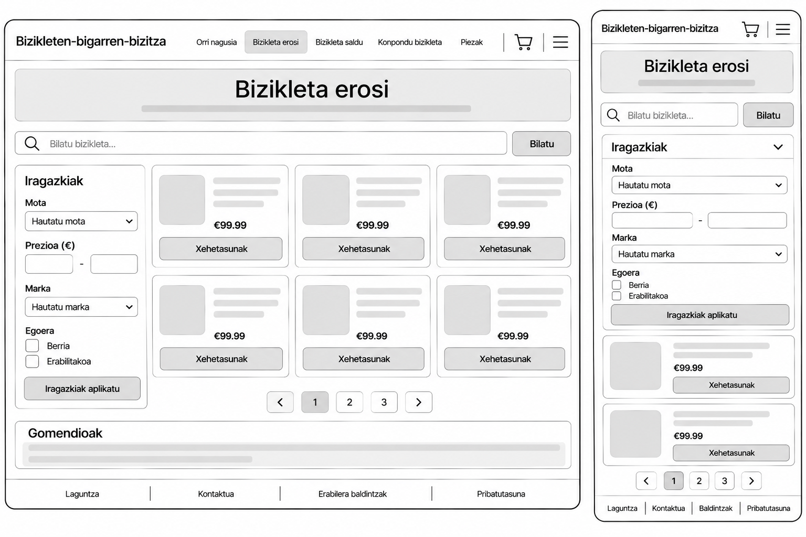
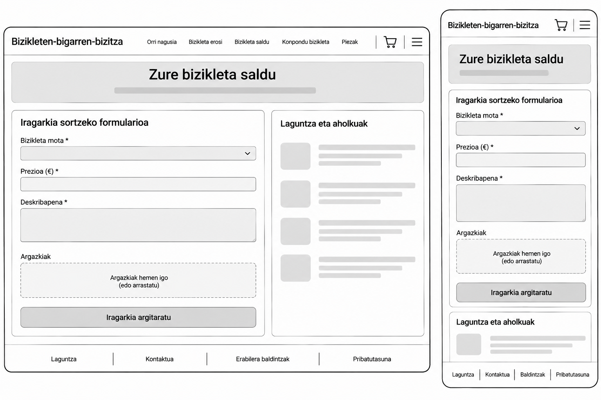
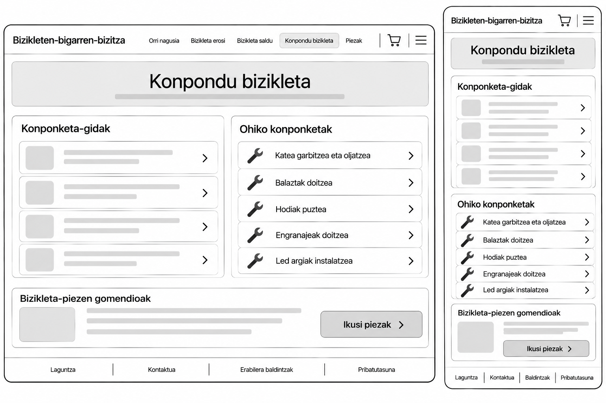
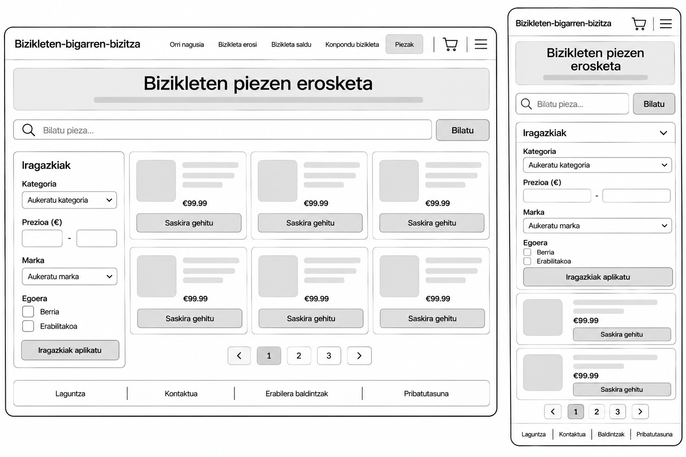
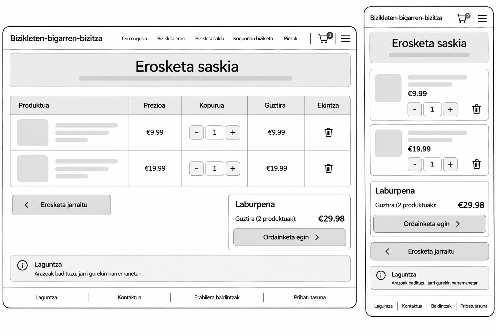

# Bizikleten-bigarren-bizitza
*Erabilitako bizikletak erosi eta saltzeko, bizikletak konpontzeko eta bizikleten piezak erosteko webgunea.*

---

## AURKIBIDEA

* [1. User Profila](#1-user-profila)
* [2. Krokisa](#2-krokisa)
  * [2.1 Mugikorra](#21-mugikorra)
  * [2.2 Ordenagailua](#22-ordenagailua)
* [3. Nabigazio Mapa](#3-nabigazio-mapa)
* [4. Estilo Gida](#4-estilo-gida)
  * [4.1 Koloreak](#41-koloreak)
  * [4.2 Tipografia](#42-tipografia)
  * [4.3 Botoiak](#43-botoiak)
  * [4.4 Irudiak](#44-irudiak)
  * [4.5 Ikonoak](#45-ikonoak) 
* [5. Erabilgarritasuna](#5-erabilgarritasuna)

---

# 1. User Profila

Webgunea **erabilitako bizikletak edo bizikleta-piezak erosi**, **bizikleta bat saldu** edo **bizikleta konpondu** nahi duten erabiltzaileentzat izango da. Erabiltzaile-profilak askotarikoak izan daitezke: bizikleta merkeago bat bilatzen duten pertsonak, bizikletaz ibiltzen hasi nahi dutenak, beren bizikleta saldu nahi dutenak edo konponketa egiteko piezak behar dituztenak.

Bizikleta erosi nahi dutenek eskuragarri dauden **iragarkiak ikusi** eta bizikletak ezaugarrien, prezioaren edo motaren arabera bilatu ahal izango dituzte. Saltzaileek bizikletaren informazioa eta argazkiak gehitu ahal izango dituzte **iragarkia sortzeko**. Konponketa egin nahi duten erabiltzaileek, berriz, aholkuak kontsultatu edo bizikleta-piezak erosi ahal izango dituzte.

Webgunea *adin eta esperientzia desberdinetako erabiltzaileek* erabili ahal izateko diseinatuko da. Horretarako, atalak argi izendatuko dira eta informazioa modu ulergarrian aurkeztuko da.

---

# 2. Krokisa

Webgunearen krokisek **orrien egitura** eta erabiltzailearen **nabigazioa** erakutsiko dituzte. Orri nagusian lau ekintza nagusi nabarmenduko dira: **bizikleta erostea**, **bizikleta saltzea**, **bizikleta konpontzea** eta **piezak erostea**. Erosketa-saskira sartzeko aukera goiburuan egongo da.

**“Bizikleta erosi”** atalean, bizikleten iragarkiak eta bilaketa-iragazkiak agertuko dira. **“Zure bizikleta saldu”** atalean, iragarkia sortzeko formularioa egongo da. **“Konpondu bizikleta”** atalean, konponketari buruzko informazioa eta gidak eskainiko dira. **“Bizikleten piezen erosketa”** atalean, eskuragarri dauden piezak ikusi eta saskira gehitu ahal izango dira.

## 2.1 Mugikorra

Mugikorreko diseinuan, atalak **menu erraz** batean bilduko dira. Orri nagusiko ekintzak botoi edo txartel argien bidez erakutsiko dira, eta produktuak pantailan bata bestearen azpian antolatuko dira. **Saskiaren ikonoa** erraz aurkitzeko moduan egongo da.

## 2.2 Ordenagailua

Ordenagailuko bertsioan, goiburuan **nabigazio-menua** eta **saskirako sarbidea** egongo dira. Pantaila zabalagoa aprobetxatuz, bizikletak eta piezak hainbat zutabetan erakutsiko dira. Salmentarako formularioa eta konponketa-gidak atal argietan antolatuko dira.

| Krokisa | Orri nagusia | Bizikleta erosi | Bizikleta saldu | Konpondu bizikleta | Piezen erosketa | Saskia |
| :--- | :---: | :---: | :---: | :---: | :---: | :---: |
| **Diseinua:** |  |  |  |  |  |  |

---

# 3. Nabigazio Mapa

Orri nagusia webguneko **abiapuntua** izango da. Goiburuko menuaren bidez, erabiltzaileak atal nagusietara joan ahal izango du:

```text
Orri nagusia
├── Bizikleta erosi
│   ├── Bizikleten zerrenda
│   └── Bizikletaren xehetasunak
├── Zure bizikleta saldu
│   └── Iragarkia sortzeko formularioa
├── Konpondu bizikleta
│   ├── Konponketa-gidak
│   └── Piezekin lotutako gomendioak
├── Bizikleten piezen erosketa
│   └── Piezen xehetasunak
└── Erosketa saskia
    ├── Saskian dauden produktuak
    └── Erosketa amaitu
```
---

# 4. Estilo Gida
## 4.1 Koloreak:
> Ze transmititu nahi dut koloreekin.

Pentsatu diren koloreak dira **txuria** nagusiki, web orriaren itxura nagusia izango da zuri kolorea, garbitasuna transmitituko duen kolore honetan pentsatu dugu orria argia eta garbia izateko. Botoi berdeetan txuri kolorezko letrak egongo dira.

**Berdea** orrien izenburuetarako, botoi nagusietarako ere, eta ikono batzuetarako baita ere. Berdea naturaren kolorea errepresentatuko du, aldi berean kolore modernoa da gaur egun. Txuriarekin nahiko ondo geratzen da.
**Beltza** erabiliko da textu eta letra gehienetan. Zuriarekin kontraste absolutoa egingo du web orrian irakurketa aldetik arazorik gabe egin ahal izateko. Baita ere Header enan erabiltzea pentsatu da web orriaren edukiengan kontraste egiteko.
**Zuri-grisdun** bat erabiliko da footer-en botoiendako. Erabiltzaileari koloreekin ez saturatzeko, kontraste ligero bat egingo du orriko txuriko fondoarekin.

| Orriko koloreak | Zuria | Berdea | Beltza | Grisa | Gorria |
| :--- | :---: | :---: | :---: | :---: | :--: |
| **Letra:** | #ffffff | #14e61c | #252f26 | #e5e5e5 | #ff2323 |

> Gorria zakarrontziko ikonoan erabiliko da.

## 4.2 Tipografia:
> Ze letra konkretuki, zertarako

| Tipografia | Open Sans | Baloo | Coiny | Fredoka One | PT Sans Narrow |
| :--- | :---: | :---: | :---: | :---: | :--: |
| **Letra:** | Web orriko azalpenetan, edo esplikazio xehatuetan erabiliko da.  | Soilik orriko botoietako testuetan erabiliko da. | Izenburuetan soilik erabiliko da tipografia hau. | Goiburuetan bakarrik erabiliko da. | Orriko formulario atal guztietan erabiliko da. |


Erabili nahi den tipografia mota, **biribildun letrak** duen tipografiak dira. Bizikleten gurpilak biratzen dutelako, pentsatu dugu bizikletan eta gurpilak zirkulu formako mugimendu konstante bat egiten dutenez, tematika hori implementatu nahi da gure web orrian. Bizikletako tematika eukitzeaz gain, biribildun letrak nahiko modan edo asko erabiltzen den tipografiak dira. Zeriotasuna kentzen dio web orriari, web orriari lagunkoia sentzazinora bideratu nahi da, eta noski, itxura aldetik bikain komplementatzen da.

## 4.3 Botoiak
> Tamaina, kolore eta erabilera

Botoien tamainak nagusiki, handiak izatea pentsatu da. Erabiltzaileei errazaztasuna emateko ahalik eta askarren identifikatzeko botoi desberdinak. Gainera, adin gehien dituen pertsonek edo bista galtzen hari duten pertsonek, edo betaurrekoak erabili behar duten pertsonetan pentsatuz, hauek asko eskertuko dituzte horrelako tamainak erabiltzea. Botoi bakoitzaren erabileraren arabera, botoiak kolore bat edo beste bat edukiko dute.
Botoi garrantsitzuenak edo erabiltzaileek erraz identifikatu behar duten botoiak, berde kolorezkoak izango dira letra txuriekin. Orriko estiloa jarraitu dezan, kontraste bikain bat egingo du. Botoien erabilera beste orrietara juteko, edukien informazio gehiago ikusi ahal izateko edo produktuak erosteko edo saltzeko erabiliko dira. Orrian garrantzia asko izango dute, erabiltzaileek web orri erraz bat erabiltzea nahi delako.

Botoiak handiak izatea pentsatu dugu. Botoi guztiak ez dituzte tamaina berdina izango, baina botoi guztiak haren gurasoen (sartuta dauden elementuen) 25% - 40% beteko dituzte altuera aldetik, eta zabalera aldetik ere elementuen tamainarekin oinarrituz, zabalera gehiago edo gutxiago izango du. Adibidez, produktuen botoiak altuera 3vh unitatea edo gehiago izan dezakete, header dauden botoiek 2vh, beste batzuk 4vh edukiko dituzte, eta zabalera aldetik sartuta dauden elementuen %92 -a beteko dituzte. Footer zabalera 4fr edukiko ditu. Eta haren botoi bakoitza footereko 1fr osatuko dituzte.

## 4.4 Irudiak
> Tamaina, kolore eta erabilera

Irudiak div edo card elementuen barruan egongo dira. Honek eukiko dituen tamaina aldatuko da pantailaren arabera. Responsive orri baten bilakaeran, konturatu gara elementuen tamainak ondo kontrolatzea garrantsitsua dela. Beraz, irudiak ez dituzte eukiko tamaina finko bat. Orduan, irudiak tamaino maximo edo minimo bat edukiko bai dute, edozein pantailan automatikoki ajustatuko dira. Irudiak, nagusiki, produktuen errepresentazino grafiko bat izango dira. Hau da, erabiltzaileak irudian ikusten duena da saltzen den produktu bera. Beraz, tamaina on bat izan beharko du, produktua detaile onetan ikusteko kolore garbiak nun kontraste onak egin beharko ditu web orriko koloreekin, eta haien erabilera produktua erakustea izango da. 

## 4.5 Ikonoak
> Tamaina, kolore eta erabilera

Web orriak botoiez gain, ikur edo ikono gutxi batzuk izango ditu. Saskiaren atalari nagusiki dedikatuko zaio euren erabilera. Produktuak gordetzeko edo ezabatzeko, edo sazki zesta atalara juteko implementatuko dira ikurrak. Ikur garbi, sinple eta tamaina modestoak izango dituzte. Ikur gutxi egongo dira, baina erabilera aldetik, nahiko fundamentalak izango dira.

---

# 5. Erabilgarritasuna
> 10 printzipioetatik zeintzuk kontuan hartu ditut, informazioa nun kokatu dudan (F / Z patroiak).


10 printzipioak barne eukitzea bururatu zaigu, baina, azkenean haietik garrantsia edo gehien kontuan izan ditugun printzipioak hauek dira:
**Sistemaren eta mundu errealaren arteko lotura** eta **Koherentzia eta estandarrak.** Erabiltzaileei esperientzia erraztu nahi diogu, orrien erabilera erraza eta lagungarria izateaz gain, gauzak ondo esplikatuta egongo dira, hizkuntza erraza erabiliko da eta zaiatuko gara publiko guztiek bizikleten inguruko gauzak ulertzea arazorik gabe.
**Erabilera-malgutasuna eta efizientzia.** erabiltzaileari esperientza on bat sortu nahi diogu, horretarako, erabiltzaile ez-esperimentatuei gauzak erraztu behar diegu ahalik eta gehien. Lasterbide lagungarriak eta implementatzea pentsatu da.
**Estetika eta diseinu minimalista.** Web orria estetika eta diseinua sainduko du. Soberan dauden gauzak inplementatzea murriztuko da ahalik eta gehien.

Informazioa ondo sakabanatu nahi izan dugu pantaila guztietan. Pantailak dituen pixel guztiak aprobetzatu nahian. Z patroian oinarritu gara, erabiltzaileak begiradada egiterakoan, ez zentratzeko bakarrik web orriko goiko aldean soilik.

Laburbilduz, web orri bat erraza erabiltzeko, publiko guztiengan pentsatuz, itxura argia eta garbia duena. Edukia ondo sakabanatuta duena eta esperientzia desatzegina ahalik eta gehien saihesten duena.
